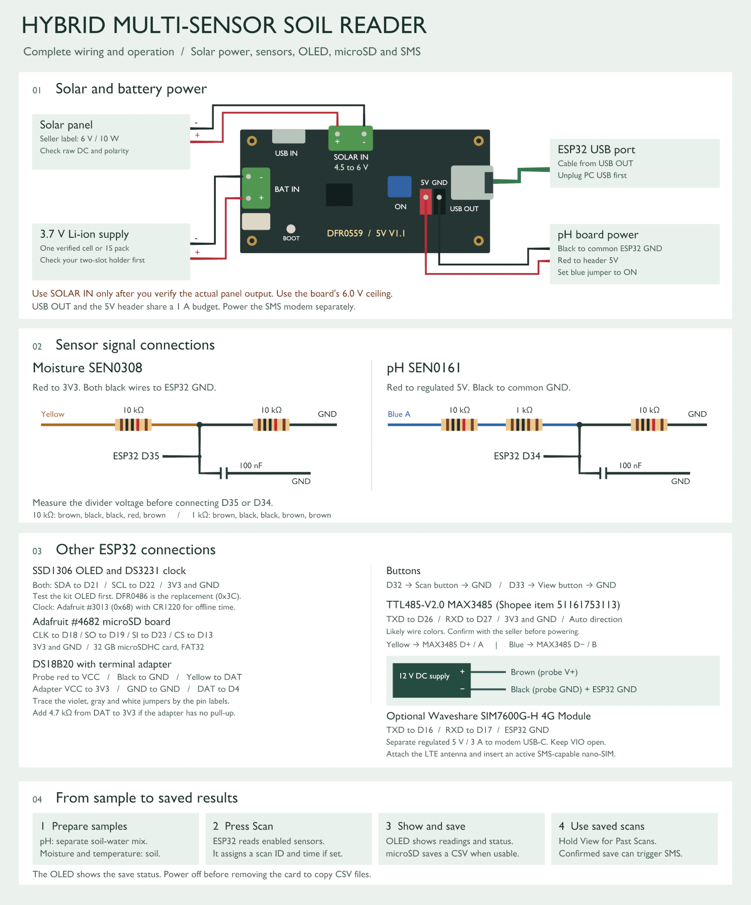

# Hybrid Multi-Sensor Soil Reader

[Open the wiring model](../models/blend-files/solar_to_reading.blend) · [View the full diagram](../models/images/solar_to_reading.png)



## Materials check

Use this list with the diagram. The LAFVIN kit already lists the ESP32 board, a 0.96-inch OLED, an 830-point breadboard, a micro-USB cable, jumper wires, buttons, and an assortment of 220 Ω, 1 kΩ, and 10 kΩ resistors. Check the OLED in your kit against the wiring table before buying another one. [LAFVIN kit contents](https://lafvintech.com/products/lafvin-basic-starter-kit-for-esp32-esp-32s-wifi-i-ot-development-board-for-arduino-project-learning-kit-with-tutorials)

| Group | Parts or tools to have |
| --- | --- |
| ESP32 bench setup | 1 classic ESP32 DevKit, 1 USB data cable, 1 breadboard, and jumper wires that fit the headers you have. |
| Moisture and pH | 1 SEN0308, 1 SEN0161 interface board and its BNC probe, **four 10 kΩ resistors, one 1 kΩ resistor, and two 100 nF ceramic capacitors**. Use a verified regulated 5 V supply for the SEN0161. |
| Soil temperature | 1 waterproof DS18B20 probe, its `DAT` / `VCC` / `GND` terminal adapter, and three jumper wires. Have a **4.7 kΩ** resistor if your adapter has no built-in pull-up. |
| Display and controls | 1 four-pin 128×64 I2C SSD1306 and 2 normally open momentary buttons for Scan and View. |
| Storage and time | 1 compatible 3.3 V SPI microSD breakout and 1 FAT32 microSD card. Add 1 DS3231 and its board-specific backup cell for offline timestamps. Have a PC card reader if needed. |
| Solar and battery | 1 DFR0559, the panel, 1 compatible 3.7 V rechargeable cell or pack, and an insulated matching holder or connector. Check the panel's raw DC output and the cell rating. Use the cooling pad and fin specified for the DFR0559 with the listed 10 W panel. |
| Optional NPK | 1 MLE05243 probe, 1 red `TTL485-V2.0` MAX3485 adapter (Shopee item **51161753113**), and a separate regulated supply rated for the probe. The probe wiring chart is still needed. [Selected adapter](https://shopee.ph/1PCS-MAX3485-Module-TTL-To-RS485-Module-MCU-Development-Accessories-i.293710525.51161753113) |
| Optional SMS | 1 Waveshare SIM7600G-H carrier, its matching LTE antenna, active SMS-capable nano-SIM, and a separate regulated 5 V / 3 A bench supply with a suitable cable. |
| Final assembly | Enclosure, mounts, insulated leads or terminals, and cable strain relief. Select any master switch or fuse for the actual load and wiring. Make the screen, buttons, microSD, and power connections accessible. |
| Calibration and checks | Multimeter, two pH calibration buffers or powders prepared as labeled, distilled water, pH electrode storage solution, and a clean soil-water sample cup. Use the matching reference instruments when doing thesis validation. |

The current wiring plan uses the **DFR0559 and one compatible cell or pack**. The thesis materials table still shows the old Waveshare manager and its three-slot holder. Use the DFR0559 power limits and connector map below for this hardware. [Thesis materials table](HYBRID_MULTI_SENSOR_SOIL_READER.docx) · [Parts and testing list](COMPLETE_MATERIALS_AND_TESTING_BUDGET.md)

## 1. Solar panel, power manager, and 18650

The [public listing photos](https://shopee.ph/DFRobot-solar-power-management-module-MPPT-chip-i.988758167.24060590355) show **DFRobot Solar Power Manager 5V V1.1**, matching the **DFR0559**. Check for that printing on the board you receive. Its `SOLAR IN` is marked **4.5 to 6 V** and its `USB OUT` is marked **5 V / 1 A**. The USB socket and 5 V header share the **1 A budget**. These ratings are for the DFR0559 you bought. [DFRobot specifications](https://wiki.dfrobot.com/dfr0559) · [DFRobot setup](https://wiki.dfrobot.com/dfr0559/docs/21505)

| Label on DFR0559 | What goes there |
| --- | --- |
| Green `SOLAR IN +` and `−` | The panel's verified raw DC positive and negative. Leave this input empty until the checks below pass. |
| Green `BAT IN +` and `−` **or** the adjacent white `BAT IN` socket | Use one of the two battery connectors for **one compatible rechargeable 3.7 V Li-ion cell** in an insulated holder or a compatible battery pack. Confirm positive and negative with a meter. |
| Small `USB IN` socket | Optional charging from a regulated **5 V USB charger rated for at least 1 A**. This is the input for USB charging. |
| Large `USB OUT` socket | Use a USB cable from here to the **ESP32's USB port** for portable operation. Remove the PC USB cable first. |
| Red `5V` header | **pH board red `+`**. Put the blue output jumper in its printed **`ON`** position for this setup. |
| Black `GND` next to the red header | **pH board black `−`** and the shared **ESP32 `GND`**. Use the ground label next to the `5V` header with its output enabled. |

**Panel check.** Your panel was listed as **6 V / 10 W**. Check its documented maximum open-circuit voltage. With the panel disconnected from the manager, identify the raw DC leads, check their polarity, and measure the open-circuit voltage in strong sun. Use the board's printed **6.0 V** as the maximum for this build. Keep the panel disconnected if you cannot identify a compatible raw DC output or confirm that its voltage stays within the limit. Before using it in the field, also confirm the input stays in the **4.5 to 6.0 V** operating range while charging. The panel's USB sockets are outputs. Match the panel's documented raw DC connector to the green `SOLAR IN` terminal. [DFRobot specifications](https://wiki.dfrobot.com/dfr0559)

**Battery check.** Use a cell or pack rated for **4.2 V full charge** and the manager's **up to 900 mA charge current**. Check the actual cell specification and holder polarity before connecting `BAT IN`. The listing's capacity alone is insufficient to verify the cell. Keep the bare cell leads off the breadboard. Follow your module's cooling instructions for a panel rated 5 W or more. If the outputs stay off after replacing the cell, follow DFRobot's `BOOT` instructions. [Battery and cooling notes](https://wiki.dfrobot.com/dfr0559/docs/21505) · [Battery selection](https://wiki.dfrobot.com/dfr0559/docs/21586)

**Shut down before moving wires.** Disconnect the panel, battery, and charger from the manager, and remove PC USB power when rewiring. `USB OUT` can stay live with the blue jumper set to `OFF`. The shared ESP32 ground can also bypass the header's ground switch, so disconnect the power sources for shutdown. Use ESP32 `3V3` for the 3.3 V modules and keep it separate from the manager's positive 5 V output. [DFRobot output details](https://wiki.dfrobot.com/dfr0559/docs/21586) · [ESP32 power options](https://docs.espressif.com/projects/esp-dev-kits/en/latest/esp32/esp32-devkitc/user_guide.html#power-supply-options)

## 2. Resistors you already have

`b` = brown, `r` = red, `bl` = black. Your ESP32 kit lists **220 Ω, 1 kΩ, and 10 kΩ**. Read each resistor with its tolerance band last. Use a multimeter with power off and the resistor out of the circuit to confirm its value. [Vishay color chart](https://www.vishay.com/docs/49411/resistor_color_code_calculator.pdf)

| Your resistor | Full band colors | Rated value |
| --- | --- | ---: |
| First, `b bl bl r b` | Brown, black, black, red, brown | **10 kΩ = 10,000 Ω**, ±1% |
| Second, `b bl bl b b` | Brown, black, black, brown, brown | **1 kΩ = 1,000 Ω**, ±1% |
| Third, `b bl bl r r` | Read from the other end as red, red, black, black, brown | **Likely 220 Ω**, ±1%. Confirm with the meter. |

**Check the third resistor before using either sensor.** Its bands can also be read as 10 kΩ ±2% in the original direction. The kit's 220 Ω option is a reason to check the direction. If you wired the third resistor into either divider, unplug power and measure it. If it reads near **220 Ω (0.22 kΩ)**, replace it with a verified **10 kΩ** resistor before testing.

**For both sensors at once, find four 10 kΩ resistors and one 1 kΩ resistor in the kit.** Use two 10 kΩ for moisture and two 10 kΩ plus one 1 kΩ for pH. Select each resistor by its measured value. Look for about **10,000 Ω** or **1,000 Ω** on the meter.

## 3. Moisture and pH signal wiring

### DFRobot SEN0308 moisture sensor

**Red → ESP32 `3V3`. Both black wires → ESP32 `GND`. Yellow → first 10 kΩ resistor.** `D35` is GPIO35. Use the two 10 kΩ resistors shown below. [DFRobot moisture pinout](https://wiki.dfrobot.com/sen0308)

```text
Yellow ── 10 kΩ ──●── 10 kΩ ── GND
                  ├──────────── D35
                  └── 100 nF ── GND
```

### DFRobot SEN0161 pH sensor

Plug the probe into the round BNC socket. **Red (`+`) → regulated 5 V. Black (`−`) → common GND. Blue (`A`) → first 10 kΩ resistor.** `D34` is GPIO34. On the bench, power the ESP32 from PC USB and use a separate 5 V source for the pH board. Join their grounds. Turn the ESP32 on first and the pH supply off first. [DFRobot pH pinout](https://wiki.dfrobot.com/sen0161)

```text
Blue A ── 10 kΩ ── 1 kΩ ──●── 10 kΩ ── GND
                          ├──────────── D34
                          └── 100 nF ── GND
```

**Measure before attaching `D35` or `D34`.** Each `●` is one electrical junction. Each capacitor is a separate **100 nF ceramic**, often marked `104`. Leave both GPIO jumpers off and power the sensor you are testing. Put the meter in DC volts, black on GND, and red on its `●`. With nominal resistors, moisture's maximum rated 2.9 V signal becomes **1.45 V**. If the pH board's `A` signal reaches 5.0 V, its junction is about **2.38 V**. These are calculations. Investigate a negative reading, an unexpected voltage, or a pH junction above about **2.45 V** before connecting that signal. Turn all power off before attaching the GPIO jumper. [ESP32 analog-input guidance](https://docs.espressif.com/projects/esp-hardware-design-guidelines/en/latest/esp32/schematic-checklist.html#adc)

## 4. ESP32 pins for the rest of the reader

Use the GPIO number printed on the board, for example `D21`, `21`, or `IO21`. This map follows the classic ESP32 DevKit and the current firmware. Match each actual module's voltage and labels before powering it. [ESP32 pin reference](https://docs.espressif.com/projects/esp-dev-kits/en/latest/esp32/esp32-devkitc/user_guide.html#header-block) · [Firmware device pins](../firmware/include/config.h) · [Firmware sensor pins](../firmware/include/sensor_settings.h)

| Part | ESP32 signal connections | Power or other connection |
| --- | --- | --- |
| SSD1306 I2C OLED | `SDA → D21`, `SCL` or I2C `SCK → D22` | Matching `VCC → 3V3`, `GND → GND`. Firmware address `0x3C`. |
| DS3231 clock | `SDA → D21`, `SCL → D22` | Use a board rated for `3V3`, including its I2C pull-ups. `GND → GND`. Clock address `0x68`. Use only the backup cell specified for that breakout. |
| 3.3 V SPI microSD board | `SCK → D18`, `MISO/DO → D19`, `MOSI/DI → D23`, `CS → D13` | Use the module's documented 3.3 V power input and GND. Insert the FAT32 card while power is off. |
| DS18B20 temperature probe and terminal adapter | Adapter `DAT → D4` (GPIO4) | Adapter `VCC → 3V3`, `GND → GND`. Follow the wire-color and resistor checks below. |
| Scan and View buttons | Scan `D32 → switch → GND`, View `D33 → switch → GND` | Pick contacts that close when pressed. The firmware enables internal pull-ups. |
| Red TTL485-V2.0 MAX3485 breakout (item 51161753113) | Adapter `TXD → D26`, adapter `RXD → D27` | `VCC → 3V3`, `GND → GND`. The pictured board handles direction automatically. Leave D25 free. |
| Waveshare SIM7600G-H carrier | Modem `TXD → D16/RX2`, modem `RXD → D17/TX2`, `GND → GND` | Separate regulated **5 V / 3 A** bench supply at its documented USB input. Use its default 3.3 V logic with `VIO` open. Insert the SIM and attach the antenna before power-on. |

### DS18B20 probe and terminal adapter

Unplug USB and any other power before wiring. Put the probe's bare ends into the matching green screw terminals and tighten them. Then use the three jumpers from the adapter's pin header to the ESP32. Read the printed labels on both sides of the adapter.

| Probe wire | Green screw terminal | Adapter header pin | ESP32 pin |
| --- | --- | --- | --- |
| Red | `VCC` | `VCC` | `3V3` |
| Black | `GND` | `GND` | `GND` |
| Yellow | `DAT` | `DAT` | `D4` or `GPIO4` |

**Violet, gray, and white are the jumper wires.** Find which color you plugged into each adapter header pin, then connect the other end to the ESP32 pin in the same row. Use a continuity meter to trace the wires if you cannot follow them by eye. Use **3.3 V** for this adapter so its data line is also pulled up to 3.3 V. [Seller's adapter photo](https://down-ph.img.susercontent.com/file/sg-11134201-7rcee-lttejticwthj6e) · [Matching adapter wiring reference](https://www.auscomtech.com.au/support/guides/ds18b20-waterproof-temperature-sensor-probe-with-terminal-adapter-arduino-wiring-code-troubleshooting/)

**Check the resistor on the adapter.** The seller's photo shows `472`, which means **4.7 kΩ**. With the adapter unplugged from both the ESP32 and the probe, set your meter to resistance and measure between `DAT` and `VCC`. If it reads about **4.7 kΩ**, use the adapter as it is. If the adapter has no pull-up, put one **4.7 kΩ** resistor between `DAT` and `3V3`. A four-band 4.7 kΩ resistor is yellow, violet, red, gold. The resistor connects across those two points. The `DAT` wire goes directly to `D4`. [DS18B20 datasheet, Figure 7](https://www.analog.com/media/en/technical-documentation/data-sheets/ds18b20.pdf#page=7)

### Optional NPK and SMS

**NPK adapter.** The selected Shopee listing shows a red `TTL485-V2.0` board with a four-pin header and a blue three-screw block. With the header on your left and the blue block on your right, the front labels read top to bottom as shown below. Check that your delivered board matches these labels and uses a 3.3 V MAX3485 before powering it. [Selected adapter](https://shopee.ph/1PCS-MAX3485-Module-TTL-To-RS485-Module-MCU-Development-Accessories-i.293710525.51161753113) · [Front pin labels](https://down-ph.img.susercontent.com/file/7417ca5656a50bcf8e4d1faa3f25ece5) · [Back wiring diagram](https://down-ph.img.susercontent.com/file/6581a7a4387b908612651e32c7ba8b41) · [MAX3485 datasheet](https://www.analog.com/en/products/max3485.html)

| Side | Printed labels, top to bottom | Connections in the same order |
| --- | --- | --- |
| ESP32 header | `VCC`, `TXD`, `RXD`, `GND` | ESP32 `3V3`, `D26` (RX), `D27` (TX), common `GND`. |
| Blue screw block | `GND`, `D-/B`, `D+/A` | Common ground is already shared through the header. Connect confirmed probe B to `D-/B` and confirmed probe A to `D+/A`. |

**NPK probe power.** Use a separate regulated DC supply within the probe's marked 5 to 30 V range. The model shows a **12 V bench example**. Connect the verified probe `V+` to supply positive and the verified probe `GND` to supply negative. Join supply negative to ESP32 `GND`. The adapter's `VCC` stays on 3.3 V. Keep the blue, brown, black, and yellow probe wires loose until the exact probe chart confirms their roles. Confirm the probe's Modbus address, baud rate, read function, and first register before enabling NPK. [Probe listing](https://makerlab.ph/products/rs485-output-3pin-probes-soil-npk-sensor-with-cable-2m) · [NPK scene in the Blender model](../models/blend-files/test.blend)

The seller's photo shows the label **SOIL NPK STORAGE**. Ask the seller whether your unit produces new NPK measurements from soil or returns stored values. A successful serial reply only confirms communication. [MakerLab listing photo](https://shopee.ph/RS485-Output-3Pin-Probes-Soil-NPK-Sensor-with-Cable-2M-i.18252381.24586562886)

**Keep the modem off the DFR0559 output.** The modem gets its own supply. Test it on the bench first. A suitable portable modem supply still needs validation. [Waveshare carrier manual](https://www.waveshare.com/wiki/SIM7600G-H_4G_Module) · [Project power and signal connections](WIRING_GUIDE.md#4-add-the-optional-modules-after-the-reader-can-save-a-scan)

## 5. Test in this order

1. **PC USB and moisture.** Check the divider voltage with `D35` disconnected. Turn off power before attaching `D35`. With `moistureEnabled = true`, send `read` in Serial Monitor. Record stable **Moisture input** readings in mV for dry and wet references at the same probe depth. Enter those measured endpoints and upload for your moisture index. The checked-in firmware has moisture enabled for raw mV and the calibration fields are still empty. [Sensor settings](../firmware/include/sensor_settings.h)
2. **pH by itself.** Run the powered meter test with `D34` disconnected. In two labeled calibration buffers, record each exact pH and stable junction voltage. Rinse the probe tip between buffers. Connect `D34` with power off once the voltage check passes. Enable `phEnabled`, fill in the measured pH and mV pairs, upload, and verify `read`. Use the final wiring when calibrating. [DFRobot pH procedure](https://wiki.dfrobot.com/sen0161/docs/19898) · [Upload and monitor commands](../command.md)
3. **Temperature, OLED, clock, and storage.** After checking the DS18B20 wiring, set `temperatureEnabled = true` in [sensor_settings.h](../firmware/include/sensor_settings.h), upload, and send `read` in Serial Monitor. Check for a room-temperature reading in °C, then warm the metal tip with your hand and check that the reading goes up. Add the remaining parts one at a time. If installed, set the clock in UTC with `rtc-set`. Use a soil-water sample cup for the liquid pH probe and use the moisture probe in soil. Press **Scan**, check the OLED, then hold **View** and open **Past Scans** to confirm the record is readable. Shut the reader down before removing the microSD card, then check the CSV in its `scans` folder on the PC. [Serial commands](../command.md)
4. **Optional NPK and SMS.** Add NPK only after its manual checks. Add SMS after the device can save CSVs. Confirm handset receipt separately from modem submission.
5. **Portable power.** With the panel disconnected, use a compatible battery and verify the DFR0559's 5 V output. Disconnect power before moving wires. Unplug PC USB and disconnect the separate pH bench supply. Move the ESP32 USB cable to the manager's `USB OUT` and connect the pH board to the manager's red `5V` and black `GND` headers as shown in Section 1. Reconnect the battery and check that the shared 5 V output stays steady during a scan and SD write. Keep within **1 A total** and watch for resets. Add the panel only after its input checks pass.

## 6. What happens when you press Scan

**Solar charging or battery → DFR0559 → ESP32 and sensors → Scan → OLED results and microSD CSV → Past Scans.** A scan saves when it has at least one usable reading and the SD write succeeds. A configured, idle modem may submit an SMS after a successful save. OLED readings and microSD storage work offline. Wi-Fi is optional and Bluetooth pairing is still pending in the firmware. [Firmware capture flow](../firmware/src/main.cpp) · [OLED menu](../firmware/src/display.cpp)

The NPK data path is **probe ↔ MAX3485 (item 51161753113) ↔ ESP32 D26/D27**. The probe uses its separate supply and the ESP32 powers the adapter through `3V3`. [NPK firmware](../firmware/src/npk.cpp)
